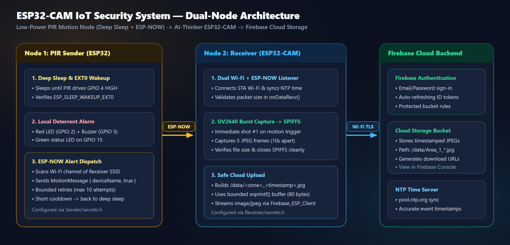
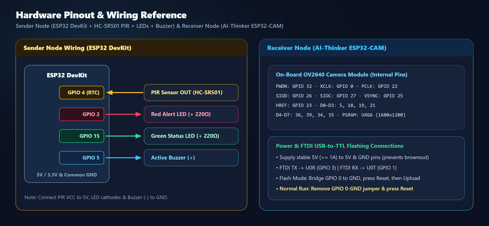

# IoT Security System with ESP32 & ESP32-CAM

A low-power, dual-node **IoT motion-activated security camera system** built with **ESP32**, **AI-Thinker ESP32-CAM (OV2640)**, **ESP-NOW**, and **Firebase Cloud Storage**—combining deep-sleep PIR motion sensing, local buzzer/LED deterrence, and automatic timestamped cloud photo capture.

[](LICENSE)


---

## Overview

Instead of keeping a power-hungry camera continuously streaming, this system splits responsibilities across two ESP32 nodes:

1. **Sender Node (`Sender/Sender.ino`) — ESP32 DevKit + PIR Sensor:** Stays in ultra-low-power **Deep Sleep** until an HC-SR501 PIR sensor pulls `GPIO 4` HIGH (`EXT0` wakeup). On wakeup, it triggers a local red LED and buzzer deterrent, matches the receiver's Wi-Fi channel, sends a wireless **ESP-NOW** `MotionMessage` packet with bounded retries, and returns to deep sleep.
2. **Receiver Node (`Receiver/Receiver.ino`) — AI-Thinker ESP32-CAM:** Stays connected to Wi-Fi and NTP (`pool.ntp.org`) while listening for ESP-NOW motion alerts. Upon receiving an alert, it immediately captures a burst of 5 high-resolution JPEG photos (`UXGA` with PSRAM, `SVGA` without) to local SPIFFS and uploads each timestamped image (`/data/<Zone>_<YYYY-MM-DD_HH-MM-SS>.jpg`) to **Firebase Cloud Storage**.

---

## Architecture & Wiring Diagrams

### Dual-Node System Architecture



### Hardware Pinout & Wiring



---

## Bill of Materials

| Component | Qty | Role |
| :--- | :---: | :--- |
| **ESP32 DevKit** | 1 | Low-power PIR motion sensor sender node |
| **AI-Thinker ESP32-CAM (OV2640)** | 1 | Camera capture & Firebase Storage uploader node |
| **HC-SR501 PIR Motion Sensor** | 1 | Motion detection (`EXT0` wakeup on `GPIO 4`) |
| **Red & Green LEDs + `220 Ω` Resistors** | 2 | Local alert & armed status indicators |
| **Active Buzzer (3.3V / 5V)** | 1 | Audible local deterrent on motion |
| **FTDI USB-to-TTL Adapter** *(or ESP32-CAM-MB)* | 1 | Programming & serial monitoring for ESP32-CAM |
| **Stable `5V >= 1A` Power Supply** | 2 | Reliable power for Wi-Fi + camera bursts |

---

## Pinout Reference (Sender Node)

| Component | ESP32 Pin | Notes |
| :--- | :---: | :--- |
| PIR Sensor `OUT` | `GPIO 4` | RTC GPIO supporting `EXT0` deep-sleep wakeup |
| Red Alert LED | `GPIO 2` | Series `220 Ω` resistor to `GND` |
| Green Status LED | `GPIO 15` | Series `220 Ω` resistor to `GND` |
| Active Buzzer `+` | `GPIO 5` | Buzzer `-` to `GND` |

---

## Getting Started

### Prerequisites (Arduino IDE)

1. Install **ESP32 Board Support** in Arduino IDE (**Preferences &rarr; Additional Board Manager URLs** &rarr; `https://espressif.github.io/arduino-esp32/package_esp32_index.json`, then install **esp32** via Boards Manager).
2. Install the **Firebase ESP Client** library by Mobizt (`Firebase_ESP_Client.h`) via Library Manager.
3. Create a **Firebase Project**, enable **Authentication (Email/Password)** and **Cloud Storage**, and create an authorized user account.

### 1. Configure & Flash the Receiver (ESP32-CAM)

1. Copy [`Receiver/secrets.example.h`](Receiver/secrets.example.h) to `Receiver/secrets.h` (gitignored) and enter your Wi-Fi and Firebase credentials:
   ```cpp
   static const char WIFI_SSID[] = "YOUR_WIFI_SSID";
   static const char WIFI_PASSWORD[] = "YOUR_WIFI_PASSWORD";
   #define FIREBASE_API_KEY "YOUR_FIREBASE_API_KEY"
   #define FIREBASE_USER_EMAIL "YOUR_FIREBASE_EMAIL"
   #define FIREBASE_USER_PASSWORD "YOUR_FIREBASE_PASSWORD"
   #define FIREBASE_STORAGE_BUCKET "YOUR_STORAGE_BUCKET_ID"
   ```
2. Open [`Receiver/Receiver.ino`](Receiver/Receiver.ino) in Arduino IDE and select **Board: AI Thinker ESP32-CAM** (Partition Scheme: **Huge APP (3MB No OTA / 1MB SPIFFS)**).
3. Bridge `GPIO 0` to `GND`, press Reset, and click **Upload**.
4. Remove the `GPIO 0` jumper, press Reset, and open **Serial Monitor (`115200` baud)**—copy the printed **`Receiver MAC Address`**.

### 2. Configure & Flash the Sender (ESP32 DevKit)

1. Copy [`Sender/secrets.example.h`](Sender/secrets.example.h) to `Sender/secrets.h` (gitignored) and paste your Receiver's MAC address and Wi-Fi SSID:
   ```cpp
   static const uint8_t RECEIVER_MAC_ADDRESS[6] = { 0xAA, 0xBB, 0xCC, 0xDD, 0xEE, 0xFF };
   static const char WIFI_SSID[] = "YOUR_WIFI_SSID";
   static const char DEVICE_NAME[] = "Area_1";
   ```
2. Open [`Sender/Sender.ino`](Sender/Sender.ino), select **Board: ESP32 Dev Module**, and click **Upload**.
3. On initial boot the Sender arms the PIR sensor and enters deep sleep. Wave in front of the PIR sensor to trigger the local alarm, ESP-NOW alert, and Firebase photo burst!

---

## Why This Was Built

Built as an affordable, modular IoT security prototype demonstrating how **ESP-NOW peer-to-peer radio**, **ESP32 deep-sleep power management**, **OV2640 JPEG capture**, and **Firebase Cloud Storage** work together without expensive commercial camera hardware. Additional project documentation is included in [`docs/IOT-Assessment-4.pdf`](docs/IOT-Assessment-4.pdf).

### Key Engineering Improvements

- **Removed hardcoded credentials:** Extracted Wi-Fi passwords and Firebase API keys out of `.ino` files into gitignored `secrets.h` templates (`secrets.example.h`).
- **Fixed filename buffer overflow (`Receiver.ino`):** Replaced fixed 30-byte `strcpy`/`strcat` path assembly (which overflowed at ~37 bytes) with safe 80-byte `snprintf()` formatting and sanitized filename characters.
- **Fixed SPIFFS leak & infinite capture loop:** Closed `File` handles in `verifyPhotoFile()` and added `MAX_CAPTURE_RETRIES` to prevent watchdog resets.
- **Fixed deep-sleep wakeup & battery drain (`Sender.ino`):** Switched from checking `esp_sleep_enable_ext0_wakeup() == ESP_OK` (always true on boot) to `esp_sleep_get_wakeup_cause() == ESP_SLEEP_WAKEUP_EXT0`, bounded ESP-NOW send retries, and replaced the 5-minute active `delay(300000)` with a configurable cooldown.

---

## Project Structure

```text
IOT-Security-System-with-ESP32-Cam-Module/
├── Receiver/
│   ├── Receiver.ino           # AI-Thinker ESP32-CAM ESP-NOW receiver & Firebase uploader
│   └── secrets.example.h      # Wi-Fi & Firebase config template (copy to secrets.h)
├── Sender/
│   ├── Sender.ino             # ESP32 PIR deep-sleep motion node & ESP-NOW sender
│   └── secrets.example.h      # Receiver MAC & Wi-Fi SSID template (copy to secrets.h)
├── docs/
│   ├── images/
│   │   ├── system-architecture.png
│   │   └── wiring-diagram.png
│   └── IOT-Assessment-4.pdf   # Original project assessment report
├── .editorconfig
├── .gitignore
├── LICENSE
└── README.md
```

---

## Contributing

Issues, hardware adaptations, and pull requests are welcome!

## License

This project is licensed under the **MIT License** — see the [LICENSE](LICENSE) file for details.
